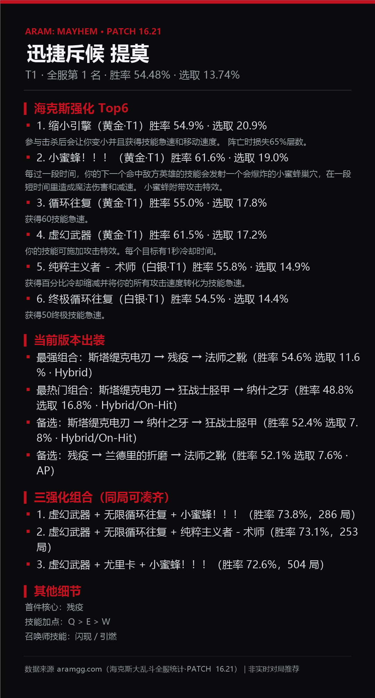

# dsh-plugin-lol-mayhem

《英雄联盟》**海克斯大乱斗（ARAM: Mayhem）** QQ 助手插件 —— DeepSeek Harness 原生 Host 插件，给「已接入 QQ 官方机器人」的 agent 用。

装上之后，群里问「提莫怎么玩」「亚索带什么海克斯」「缩小引擎是什么」「提莫和亚索谁强」「最近有什么黑马」，agent 会调本插件的工具取**当前版本真实统计**回答，可发文字，也可发一张 1080 宽的图文攻略卡。



> 上面这张就是 `lol_card` 真实生成的效果：Top6 强化（名字后直接跟机制说明）、当前版本出装、同局三强化组合、首件核心/技能加点/召唤师技能，底部标注数据来源与版本。

## 能查什么（13 个工具）

| 工具 | 作用 |
| --- | --- |
| `lol_champion` | **一个英雄的完整攻略**：梯度/全服排名/胜率/选取率 + **海克斯强化 Top6**（每条附机制说明与胜率选取率）+ **当前版本最强出装**（最强/最热/备选三件套）+ 首件核心/技能加点/召唤师技能 + **三强化组合** |
| `lol_augments` | 强化排行榜：传英雄 → 该英雄的强化榜（按该英雄适配排名）；不传 → 全服强化强度榜，可按白银/黄金/棱彩过滤 |
| `lol_augment` | 单个强化档案：中文效果说明、梯度、全服胜率/选取率、适配英雄、在哪些英雄身上排名靠前 |
| `lol_build` | 出装详情：按流派（AP / AD / Hybrid / On-Hit / 坦克…）拆开的三件套组合，可传 `tag` 只看某流派 |
| `lol_trio` | 三强化组合：同一局能凑齐的三个海克斯套装，按组合胜率排序（含样本局数） |
| `lol_compare` | 两个英雄对比：梯度/排名/胜率/选取率、各自 Top3 强化与最强出装，给出结论 |
| `lol_tier` | 英雄梯度榜 T1–T5，带胜率/选取率与推荐强化 |
| `lol_fun` | 整活/黑马：某英雄「胜率明显高于自身基线但没人拿」的强化；不传英雄 → 全服冷门高胜率英雄 |
| `lol_search` | 模糊搜索英雄与强化（支持绰号：瞎子/狐狸/电耗子/提百万…） |
| `lol_meta` | 数据版本、来源、覆盖率、抓取时间、诊断 |
| `lol_update` | 在线刷新：单英雄（几秒）或全站强化字典+物品+召唤师技能，写运行时缓存，不动物料包内快照 |
| `lol_card` | 生成 PNG 图文卡（champion/trio/augment/augments/tier/fun/meta），由 agent 随后用 `qqbot_send_file` 发到 QQ |
| `lol_help` | 菜单与示例问法 |

另外注入了 system prompt 提示：用户问海克斯大乱斗时必须调本插件工具、不要凭记忆编数据；要图时调 `lol_card` 再发文件。

## 数据来源（重要，别当成 op.gg 数据）

- **英雄级数据来自 aramgg 官方客户端的公开只读 JSON API**：`https://data.dtodo.cn/api/client/v1/`（config → dataVersion → `augments.json` / `champions.json` / `champions/<id>.json` / `items.json` / `summoner-spells.json`）。含 173 英雄、218 强化、306 物品、每个英雄的强化榜（按该英雄适配排名）、出装流派、三强化组合。
- **op.gg 没有开放英雄级海克斯统计**：op.gg 的海克斯数据只存在于模式主页的 RSC flight（262 条强化、tier 0–5、performance 分），且**没有**「某英雄 × 某强化」的胜率；op.gg 也未公开内部 JSON 接口（逆向尝试全部失败）。因此插件不伪造这部分数据。原始需求里的「接入 op.gg」无法按字面实现，这是本插件与需求的已知偏差；`lol_meta` 会在来源说明里讲清楚。
- 数据为全服统计（腾讯服样本），非实时对局推荐，标注在每张卡的 footer。
- 已知上游缺陷：三强化组合里有 2 个上游未定义的强化 id（2083/2104，显示为「未知强化 #id」）；约 7% 的单条强化因样本不足胜率为 null（显示「—」，不是 0%）。

## 安装

三种方式任选：

0. **从 GitHub 下载（给别人最省事）**：到 [Releases](https://github.com/NormalAorii/dsh-plugin-lol-mayhem/releases) 下载 `dsh-plugin-lol-mayhem-1.0.0.tgz`，然后按下面第 2 条安装；或 `git clone https://github.com/NormalAorii/dsh-plugin-lol-mayhem.git` 后按第 1 条装。
1. **本地目录安装（推荐，本机已用）**：`plugin_manager` → `install_bundle`，target 传本目录绝对路径（如 `C:\...\dsh-plugin-lol-mayhem`）；DSH 会把它装进 profile 并启用。重载 DSH 后 13 个 `lol_*` 工具即可用。
2. **离线 tgz（迁移到别的宿主）**：把 `dsh-plugin-lol-mayhem-1.0.0.tgz` 拷过去，`plugin_manager install_bundle` 传 tgz 绝对路径；或在目标 profile 目录 `npm install <tgz>`，并把 `dsh-plugin-lol-mayhem` 加进 profile `package.json` 的 `dsh.profile.bundles`。
3. **手工**：把本目录放进 profile 的 `node_modules/`，并在 profile `cordis.patch.yml` 加：
   ```yaml
   - insert:
       - id: dsh-plugin-lol-mayhem
         name: dsh-plugin-lol-mayhem
   ```

前置条件：宿主需有 `tools` 服务；`lol_card` 出图需要 Windows PowerShell + System.Drawing（没有时其他工具照常工作，卡片会返回文字兜底）。

## 数据维护

- 物料包内含 `data/snapshot.json`（全量快照，离线可用，约 1.2MB）。
- 重新抓取：插件目录运行 `npm run crawl`（默认读 `lol-probe/cache/api` 缓存，通常几秒完成）。
- 在线刷新（对话里说「刷新数据」）：`lol_update` 写 `DSH_HOME/plugin-data/dsh-plugin-lol-mayhem/snapshot.json`，优先于包内快照。
- 自检：`npm run verify`（不需要 DSH 宿主；会校验快照、13 个工具、模糊匹配并真实生成 4 张 PNG）。

## 结构

```
index.js            Cordis 入口：注册 13 个工具 + 系统提示
lib/core.js         工具适配层（defineTool 兼容、参数校验、HTTP、文本工具）
lib/store.js        快照加载/索引/查询（英雄、强化、出装、三强化组合、黑马）+ 文本清洗
lib/render.js       QQ 文本消息渲染
lib/cardview.js     卡片数据组装
lib/cards.js        1080 宽 PNG 排版（PowerShell + System.Drawing，无第三方依赖）
lib/tools.js        13 个工具定义
lib/live.js         在线刷新（复用 scripts/crawl.mjs 的解析器）
scripts/crawl.mjs   客户端 API 抓取器（库 + CLI 两用）
scripts/verify.js   离线自检
data/               快照 + 数据契约 SNAPSHOT_SCHEMA.md + ddragon 英雄索引
locale/             zh/en 元数据
```

## 许可

MIT。数据版权归 aramgg / Riot Games；本插件仅做个人查询用，不含游戏资源文件。
